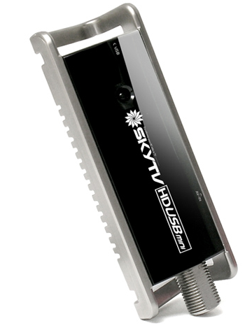
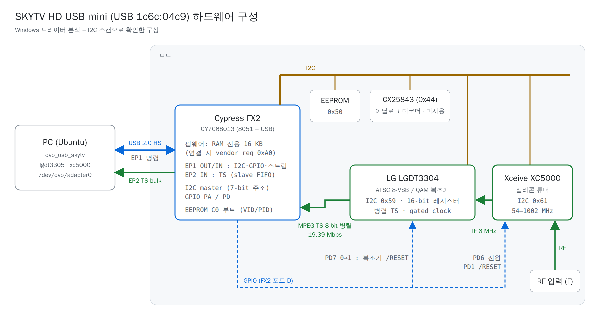
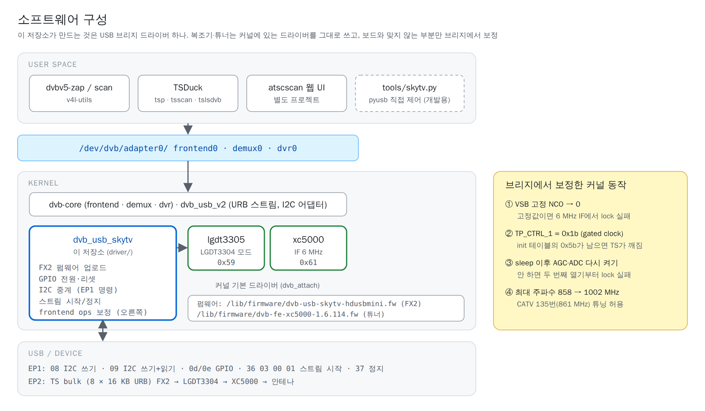
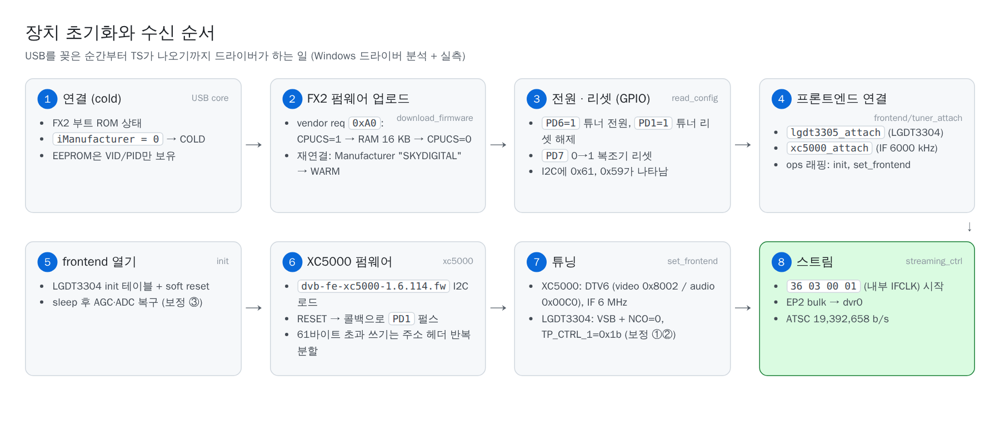
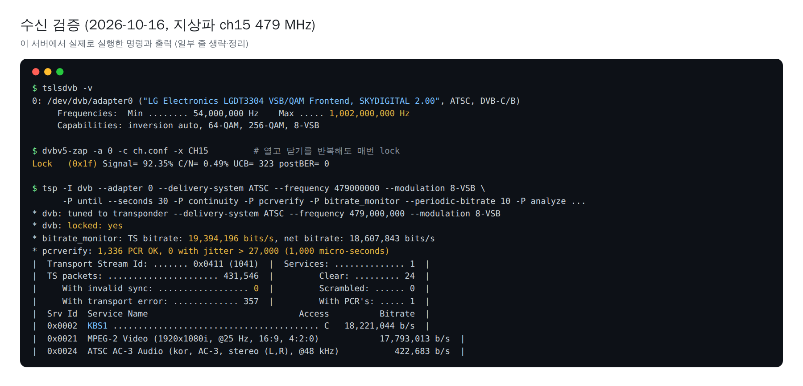

# SKYTV HD USB mini 리눅스 드라이버

<p align="center"></p>

Skydigital **SKYTV HD USB mini**(USB `1c6c:04c9`) ATSC 수신기를 리눅스에서 쓰기 위한 DVB 드라이버입니다.
제조사는 Windows 드라이버만 제공했기 때문에, 장치의 칩 구성과 USB 명령을 직접 분석해서 만들었습니다.
설치하면 일반 DVB 장치(`/dev/dvb/adapter0`)로 잡혀서 `dvbv5-zap`, TSDuck, tvheadend 같은 표준 도구를 그대로 쓸 수 있습니다.

> *English summary:* Linux DVB (dvb-usb-v2) bridge driver for the Skydigital SKYTV HD USB mini ATSC stick
> (Cypress FX2 + LG LGDT3304 + Xceive XC5000). It reuses the in-kernel `lgdt3305` and `xc5000` drivers and
> patches their board-specific behaviour from the bridge. Tested on Ubuntu 26.04 (kernel 7.0) with ATSC 8-VSB.

## 목차
- [상태](#상태)
- [하드웨어](#하드웨어)
- [소프트웨어 구성](#소프트웨어-구성)
- [설치](#설치)
- [사용](#사용)
- [TSDuck 사용 예시](#tsduck-사용-예시)
- [동작 방식](#동작-방식)
- [검증 결과](#검증-결과)
- [문제 해결](#문제-해결)
- [저장소 구성](#저장소-구성)
- [개발 과정과 기술 정리](#개발-과정과-기술-정리)
- [라이선스와 펌웨어 고지](#라이선스와-펌웨어-고지)

## 상태

| 기능 | 상태 |
|---|---|
| ATSC 8-VSB 수신 (지상파, 사내 공청 케이블망의 8-VSB 채널) | 동작 확인 |
| `/dev/dvb/adapter0` (frontend, demux, dvr) | 동작 확인 |
| lock 상태, SNR(0.1 dB 단위), 신호 품질, UCB | 동작 확인 (BER은 커널 lgdt3305가 지원하지 않아 항상 0) |
| 열기·닫기 반복, 채널 전환 | 동작 확인 |
| 54 ~ 1002 MHz 튜닝 | 동작 확인 (CATV 135번 861 MHz 포함) |
| 콜드 플러그 (USB를 꽂을 때 드라이버가 FX2 펌웨어를 올리는 경로) | **미검증** — 코드는 있지만 지금까지는 펌웨어가 이미 올라간 상태에서만 로드됨 |
| QAM (J.83B 케이블) | **미검증** — 커널 경로는 연결되어 있음 |
| 아날로그 입력 (CX25843) | 지원 안 함 |

## 하드웨어



| 부품 | 칩 | I2C (7-bit) | 리눅스 드라이버 |
|---|---|---|---|
| USB 브리지 | Cypress FX2 CY7C68013 (8051, **RAM 전용** — 연결할 때마다 펌웨어 업로드) | — | `dvb_usb_skytv` (**이 저장소**) |
| ATSC/QAM 복조기 | LG LGDT3304 | 0x59 | `lgdt3305` (커널 기본, `demod_chip = LGDT3304`) |
| 튜너 | Xceive XC5000 | 0x61 | `xc5000` (커널 기본, IF 6000 kHz) |
| 아날로그 디코더 | Conexant CX25843 | 0x44 | 사용하지 않음 |
| EEPROM | FX2 "C0" 부트 헤더 (VID/PID만) | 0x50 | — |

- RF → XC5000 → **IF 6 MHz** → LGDT3304 → **병렬 MPEG-TS**(gated clock) → FX2 slave FIFO → USB EP2 bulk
- 튜너와 복조기는 FX2 GPIO로 전원·리셋을 제어합니다: `PD6` 튜너 전원, `PD1` 튜너 /RESET, `PD7` 복조기 /RESET

## 소프트웨어 구성



이 저장소가 새로 만든 것은 USB 브리지 드라이버 하나입니다. 하는 일은 다음과 같습니다.

- FX2 펌웨어 업로드 (vendor request `0xA0`)
- GPIO 전원·리셋
- I2C 중계 (EP1 명령)
- TS 스트림 시작/정지

복조기·튜너는 커널에 있는 드라이버를 `dvb_attach()`로 붙입니다. 커널 `lgdt3305`의 LGDT3304 경로는 다른 제품(KWorld 340U)
기준이라 이 보드와 네 군데가 맞지 않았고, 커널 모듈을 고치지 않고 브리지에서 해당 프론트엔드 인스턴스의 ops만 감싸서 보정했습니다.

| # | 커널 동작 | 증상 | 브리지의 보정 |
|---|---|---|---|
| ① | VSB에서 CR_CTR_FREQ(0x0106~0x0109)에 고정값 0x4f0cacba 기록 | 6 MHz IF에서 lock 실패 | `set_frontend` 후 0으로 (Windows 드라이버와 같음) |
| ② | init 테이블이 TP_CTRL_1(0x050e)=0x5b, 극성 함수가 bit6을 지우지 않음 | lock은 되지만 TS가 깨짐 | `set_frontend` 후 0x1b (칩 기본값, gated clock) + soft reset |
| ③ | `sleep()`이 AGC 핀 tristate, ADC/VSB 끄기 → LGDT3304 init이 복구하지 않음 | 처음 한 번은 되고, 닫았다 다시 열면 lock 실패 | `init` 래핑: 0x0002 &= ~0x06, 0x000a \|= 0x03 |
| ④ | `info.frequency_max_hz` = 858 MHz | 861 MHz 튜닝 요청 거부 | 1002 MHz로 상향 (XC5000은 1023 MHz까지) |

## 설치

Ubuntu 26.04, 커널 7.0에서 확인했습니다.

### 1. 패키지
```sh
sudo apt-get install -y build-essential linux-headers-$(uname -r) dkms dvb-tools linux-firmware
# 선택: TSDuck (https://tsduck.io), 펌웨어 추출용 unzip 7zip unshield, 개발 도구용 python3-usb
```
XC5000 튜너 펌웨어 `dvb-fe-xc5000-1.6.114.fw`는 `linux-firmware` 패키지에 들어 있습니다.

### 2. FX2 펌웨어
저장소의 `firmware/dvb-usb-skytv-hdusbmini.fw`를 복사합니다.
```sh
sudo cp firmware/dvb-usb-skytv-hdusbmini.fw /lib/firmware/
```
제조사 드라이버 패키지에서 같은 파일을 직접 추출할 수도 있습니다(SHA-256으로 검증).
```sh
tools/extract_firmware.sh "SKYTV HD USBmini_v2-7-2p3.zip"     # 또는 설치 exe, x86/skyhdmc.sys
# OK: dvb-usb-skytv-hdusbmini.fw (16384 bytes, sha256 matches)
```
| 파일 | SHA-256 |
|---|---|
| `dvb-usb-skytv-hdusbmini.fw` (16384 B) | `50f84422e8699fed3f0388b9a529a9c4b90edad9595ae3b955adf481aec9c85a` |
| 원본 `x86/skyhdmc.sys` (드라이버 1.3.9.97) | `6dea5546aed524110fa1f5a62b446c7d62a41a6f0f5ad21141b317252a0ece50` |

### 3. 드라이버 (DKMS 권장)
```sh
sudo mkdir -p /usr/src/dvb-usb-skytv-1.0
sudo cp driver/{dvb_usb_skytv.c,dvb_usb.h,lgdt3305.h,xc5000.h,Makefile,dkms.conf} /usr/src/dvb-usb-skytv-1.0/
sudo dkms add dvb-usb-skytv/1.0
sudo dkms install dvb-usb-skytv/1.0
sudo modprobe dvb_usb_skytv
```
DKMS(`AUTOINSTALL=yes`)에 등록되면 새 커널을 설치할 때 자동으로 다시 빌드됩니다. 의존 모듈 `dvb_usb_v2`, `lgdt3305`, `xc5000`은 자동으로 로드됩니다.

DKMS 없이 시험만 해 보려면:
```sh
cd driver && make
sudo modprobe -a dvb_usb_v2 lgdt3305 xc5000 && sudo insmod dvb_usb_skytv.ko
```
- 소스를 고친 뒤: `/usr/src/dvb-usb-skytv-1.0/`에 다시 복사하고 `sudo dkms install dvb-usb-skytv/1.0 --force` 후 `sudo rmmod dvb_usb_skytv; sudo modprobe dvb_usb_skytv`
- 제거: `sudo dkms remove dvb-usb-skytv/1.0 --all`
- `driver/dvb_usb.h`, `lgdt3305.h`, `xc5000.h`는 커널 소스 v7.0의 내부 헤더 사본입니다. 커널 메이저 버전이 크게 바뀌면 같은 버전의 헤더로 바꿔야 할 수 있습니다.

### 4. 확인
```sh
sudo dmesg | grep -iE "skytv|LGDT3304|xc5000"
#  dvb_usb_v2: found a 'Skydigital SKYTV HD USB mini' in warm state
#  DVB: registering adapter 0 frontend 0 (LG Electronics LGDT3304 VSB/QAM Frontend)...
#  xc5000: Successfully identified at address 0x61
ls /dev/dvb/adapter0          # demux0 dvr0 frontend0 net0
```
`/dev/dvb`는 `root:video` 권한이므로 사용자 계정을 `video` 그룹에 넣으면 sudo 없이 쓸 수 있습니다(`sudo usermod -aG video $USER`, 다시 로그인).

## 사용

```sh
# 채널 스캔 (한국 VHF/UHF 6 MHz 채널표)
dvbv5-scan -a 0 -T 4 -o channels.conf tools/kr-atsc-scan.conf

# 채널 이름으로 튜닝
dvbv5-zap -a 0 -c channels.conf -r KBS1                    # /dev/dvb/adapter0/dvr0 로 출력
dvbv5-zap -a 0 -c channels.conf -P -o out.ts -t 30 KBS1     # 30초 녹화 (모든 PID)
```
`channels.conf`는 이 장치로 사내망에서 스캔한 예시입니다(지역마다 다름). tvheadend, MythTV 같은 DVB 프로그램에서도 그대로 쓸 수 있습니다.

## TSDuck 사용 예시

모두 이 장치에서 실제로 실행해 확인한 명령입니다. 주파수는 채널 중심 주파수(Hz)이고, 한국 지상파는 ch14 = 473 MHz, ch15 = 479 MHz … (6 MHz 간격)입니다.

### 장치와 채널 찾기
```sh
tslsdvb -v                                   # 어댑터, 지원 시스템, 주파수 범위, 현재 lock 상태
# UHF 14~51 스캔. 이 TSDuck 버전의 korea 지역에는 UHF 정의가 없어서 같은 6 MHz 채널표인 --usa 사용
tsscan --usa --uhf-band --first-channel 14 --last-channel 51 --service-list --show-modulation
tsscan --usa --vhf-band --service-list       # VHF 2~13
```

### 튜닝해서 상태 보기 / 녹화
```sh
# 30초 수신하면서 연속성·PCR·비트레이트 검사, 분석 결과는 an.txt, TS는 rec.ts로 저장
tsp -I dvb --adapter 0 --delivery-system ATSC --frequency 479000000 --modulation 8-VSB \
    -P until --seconds 30 \
    -P continuity -P pcrverify -P bitrate_monitor --periodic-bitrate 10 \
    -P analyze -o an.txt \
    -O file rec.ts

# lock 상태를 JSON으로 2초마다 출력 (lgdt3305가 DVBv5 통계를 제공하지 않아 SNR/세기는 나오지 않음)
tsp -I dvb --adapter 0 --delivery-system ATSC --frequency 479000000 --modulation 8-VSB \
    --json-line='STATUS:' --json-interval 2 -P until --seconds 10 -O drop
```

### PSIP / PSI 테이블 보기
```sh
# 실시간: MGT, TVCT(가상채널), STT(방송 시각) — 모두 PID 0x1FFB
tsp -I dvb --adapter 0 --delivery-system ATSC --frequency 491000000 --modulation 8-VSB \
    -P until --seconds 6 -P tables --pid 0x1FFB --max-tables 4 -O drop

# EIT/ETT(편성표)까지 전부 — EIT PID는 MGT가 정하고 방송사마다 다르므로(KBS 0x1D00~, SBS 0x1A00~) PID를 지정하지 않음
tsp -I dvb --adapter 0 --delivery-system ATSC --frequency 485000000 --modulation 8-VSB \
    -P until --seconds 15 -P tables -O drop

# 녹화 파일에서
tstables --pid 0x1FFB --max-tables 3 rec.ts       # MGT / TVCT / STT
tsanalyze rec.ts                                  # 서비스, PID, 비트레이트 요약
```

### 서비스만 골라내기 / 네트워크로 보내기
```sh
tsp -I file rec.ts -P zap KBS1 -O file kbs1.ts                   # 한 서비스만 (PAT/PMT 재구성)
tsp -I file rec.ts -P filter --pid 0x21 --pid 0x24 -O file av.ts  # 원하는 PID만

# 수신한 TS를 UDP 멀티캐스트로 송출 (VLC 등에서 udp://@239.1.1.1:1234 로 재생)
tsp -I dvb --adapter 0 --delivery-system ATSC --frequency 479000000 --modulation 8-VSB \
    -O ip --ttl 4 239.1.1.1:1234
```

### 참고
- 녹화 파일 시작이 패킷 경계와 맞지 않아 `tsp -I file`이 "cannot detect TS file format"으로 실패하면
  `python3 tools/tsclean.py in.ts out.ts`로 정렬된 패킷만 다시 씁니다.
- 수신 시작 직후 수백 패킷 안에서, 존재하지 않는 PID에 CC 오류가 몇 건 나오는 것은 시작 시점의 잔여 데이터입니다.

## 동작 방식



### FX2 펌웨어 명령 (EP1 OUT 명령 / EP1 IN 응답)

| 명령 | 형식 | 응답 |
|---|---|---|
| 0x08 I2C write | `08 addr len data…` (data 최대 61바이트, 주소는 7-bit) | `st` (0x08=OK, 0x07=NACK, 0x06=bus error) |
| 0x09 I2C write+read | `09 wlen rlen addr wdata…` | `st data…` |
| 0x0d port read | `0d port` (0=PA, 3=PD) | `val` |
| 0x0e port write | `0e port OE val` | `st` |
| 0x36 stream start | `36 03 00 clk` (clk=1: 내부 IFCLK — 이 보드에서 동작, 0: 외부 IFCLK — 데이터 없음) | 없음 |
| 0x37 stream stop | `37` | 없음 |

- TS 데이터: bulk EP2 IN (0x82), alt setting 0. 드라이버는 16 KB URB 8개로 받습니다.
- 펌웨어 적재 판단: 부트 ROM 상태는 `iManufacturer = 0`, 펌웨어 실행 후에는 "SKYDIGITAL"
- FX2 EP1 버퍼가 64바이트라, 61바이트를 넘는 XC5000 펌웨어 쓰기는 2바이트 주소 헤더를 반복해서 나눠 보냅니다(xc5000 드라이버가 스스로 나눌 때와 같은 방식).
- 세션을 연 직후 EP1 첫 응답이 가끔 유실되므로 300 ms 타임아웃 후 다시 보냅니다.

### 설정값
- XC5000: IF 6.000 MHz, DTV6 (VIDEO_MODE 0x8002 / AUDIO_MODE 0x00C0), signal source air, output amp 0x8a
- LGDT3304: 병렬 TS, 클럭 하강 에지, gated clock, valid high, 스펙트럼 반전 off
- 튜너 리셋 콜백: `PD1` 0 → 10 ms → 1

## 검증 결과



2026-10-16, 지상파 ch15(479 MHz, KBS1 9.1) 기준입니다.

| 항목 | 결과 |
|---|---|
| lock | `dvbv5-zap` status 0x1f, TSDuck "locked: yes" |
| 비트레이트 | 19,392,8xx b/s로 안정 (ATSC 8-VSB 19,392,658 b/s) |
| 30초 TSDuck 수신 (431,546 패킷) | invalid sync 0, PCR 1,336개 모두 정상(지터 1 ms 초과 0건) |
| 연속성 오류 | 시작 직후 첫 351개 패킷 안에서만, 존재하지 않는 PID에서 발생 |
| 전송 오류(TEI) 표시 패킷 | 357개 (0.08%). 신호 품질에 따라 달라지며, 원인은 따로 분석하지 않음 |
| 10초 녹화(dvbv5-zap) | 연속성 오류 0, MPEG-2 1080i 영상과 AC-3 음성 정상 디코딩 |
| 연속 튜닝 | sleep을 거쳐 ch15 → ch16 → ch3 → ch15 모두 lock |
| 채널 스캔 | 지상파 MBC, KBS1, SBS, KBS2와 VHF 3~5번, 사내망 케이블 8-VSB 채널 다수 lock |

## 문제 해결

| 증상 | 확인 |
|---|---|
| `/dev/dvb/adapter0`가 없음 | `lsusb \| grep 1c6c`, `sudo dmesg \| grep -i skytv`, `modinfo -n dvb_usb_skytv` (DKMS 설치 여부) |
| dmesg에 펌웨어 관련 오류 | `/lib/firmware/dvb-usb-skytv-hdusbmini.fw` 위치와 SHA-256 확인 |
| "xc5000: no tuner reset callback" | 이 드라이버가 아닌 다른 브리지가 장치를 잡은 경우. `lsmod`로 확인 |
| 첫 튜닝은 되는데 다시 열면 lock 안 됨 | 보정 ③이 없는 이전 빌드. DKMS로 최신 소스를 다시 설치 |
| lock은 되는데 TS가 깨짐 | 보정 ② 확인. 사용자 공간 도구 `tools/kpath.py`로 레지스터 순서를 재현해 볼 수 있음 |
| 특정 주파수에서 "lock은 됐는데 데이터 없음" | 아주 약한 신호에서 lock 비트만 켜지는 경우가 있음. SNR이 10 dB 미만이면 안테나·분배기 확인 |
| 커널 업데이트 후 장치가 사라짐 | `dkms status`로 새 커널용 빌드 확인 |
| Secure Boot 시스템에서 로드 거부 | 모듈을 MOK 키로 서명해야 함 (`mokutil --sb-state`) |

## 저장소 구성

```
driver/            dvb_usb_skytv.c (브리지 드라이버), Makefile, dkms.conf,
                   dvb_usb.h · lgdt3305.h · xc5000.h (커널 v7.0 내부 헤더 사본)
firmware/          dvb-usb-skytv-hdusbmini.fw (FX2 8051 펌웨어 16 KB, 제조사 Windows 드라이버에서 추출)
tools/
  extract_firmware.sh   제조사 드라이버 패키지에서 FX2 펌웨어 추출 + SHA-256 검증
  skytv.py              커널 드라이버 없이 pyusb로 장치를 직접 제어 (펌웨어 업로드, I2C, 튜닝, TS 캡처)
  kpath.py              커널 lgdt3305의 LGDT3304 레지스터 순서를 사용자 공간에서 재현 (보정 검증용)
  tsclean.py            TS 파일을 188바이트 경계로 다시 정렬
  kr-atsc-scan.conf     dvbv5-scan용 한국 VHF/UHF 채널표
channels.conf      dvbv5-scan 결과 예시
skills/            드라이버를 만드는 데 쓴 기술 정리 (SKILL.md 9개)
docs/images/       README 그림 (src/의 HTML을 render.py로 PNG 렌더링)
```

### 개발용 도구 사용 예
```sh
sudo rmmod dvb_usb_skytv                      # 커널 드라이버가 장치를 잡고 있으면 먼저 내림
sudo python3 tools/skytv.py --scan            # 펌웨어 업로드 → 전원 → XC5000 펌웨어 → VHF/UHF lock 스캔
sudo python3 tools/skytv.py --ch 15 --secs 5 --intclk --out ch15.ts
```

## 개발 과정과 기술 정리

[`skills/`](skills/README.md)에 단계별로 정리했습니다. 각 문서는 Claude Code 스킬 형식(`SKILL.md`)이라
`~/.claude/skills/`에 복사하면 스킬로도 쓸 수 있습니다.

1. [USB 장치 식별](skills/01-usb-device-identification/SKILL.md): 엔드포인트 구조로 FX2 추정, 커널 미지원 확인
2. [Windows 드라이버 추출](skills/02-windows-driver-extraction/SKILL.md): InstallShield 풀기, INF와 PDB 경로에서 칩 단서 찾기
3. [FX2 펌웨어 분석](skills/03-fx2-firmware-reverse-engineering/SKILL.md): 8051 디스어셈블(d52), EP1 명령 테이블 복원
4. [Windows .sys 분석](skills/04-windows-sys-reverse-engineering/SKILL.md): objdump로 GPIO 순서, 레지스터 테이블, 튜너 IF 찾기
5. [I2C 스캔과 칩 식별](skills/05-i2c-probing-chip-identification/SKILL.md): 커널 probe 절차 재현으로 LGDT3304·XC5000 확정
6. [pyusb 프로토타입](skills/06-userspace-prototyping-pyusb/SKILL.md): 커널 없이 튜닝·TS 수신 검증
7. [dvb-usb-v2 브리지 드라이버](skills/07-dvb-usb-v2-bridge-driver/SKILL.md): 프레임워크 구성과 ops 래핑 보정
8. [모듈 빌드와 DKMS](skills/08-kernel-module-build-dkms/SKILL.md)
9. [TS 검증](skills/09-ts-verification-tsduck/SKILL.md): dvbv5, TSDuck, ffprobe

## 라이선스와 펌웨어 고지

- 드라이버와 도구 소스(`driver/`, `tools/`)는 **GPL-2.0-or-later**입니다([COPYING](COPYING)). `driver/`의 커널 헤더 사본은 리눅스 커널의 라이선스(GPL-2.0)를 따릅니다.
- `firmware/dvb-usb-skytv-hdusbmini.fw`는 Skydigital이 배포한 Windows 드라이버(`skyhdmc.sys` 1.3.9.97)에서 추출한 바이너리로,
  **저작권은 제조사에 있으며 이 저장소의 라이선스가 적용되지 않습니다.** 장치 소유자가 리눅스에서 사용할 수 있도록 함께 두었습니다.
  재배포가 문제 되는 환경이라면 이 파일 대신 `tools/extract_firmware.sh`로 직접 추출하세요.
- `docs/images/hdmini.png`는 제품 사진입니다.
- 제조사와 관계없는 비공식 드라이버입니다. 사용에 따른 책임은 사용자에게 있습니다.
